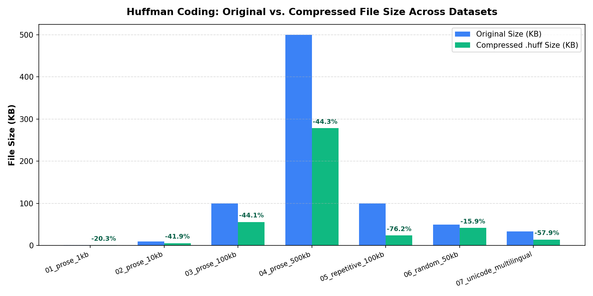
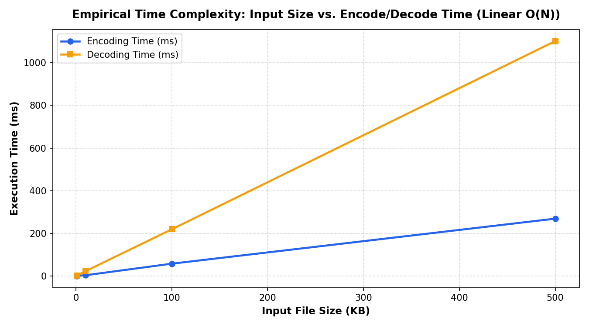

# File Compression Using Huffman Coding (DAA Capstone Project)

A production-grade, lossless **bit-level text file compression and decompression system** built in Python using **Huffman Coding**, complete with a custom `.huff` binary container format, CLI tool, interactive Streamlit web dashboard, automated DAA complexity benchmarking, and a `pytest` verification suite.

---

## 1. Problem Statement
Develop a file compression system using **Huffman Coding** that reduces the storage space required for text files. The system calculates character frequencies, constructs a Min-Heap based **Huffman Tree**, generates optimal prefix-free binary codes, performs true bit-level encoding and decoding, analyses time and space complexity, and compares original vs. compressed file sizes across diverse datasets.

---

## 2. Algorithmic Theory (Greedy Paradigm)
Huffman Coding is a classic **Greedy Algorithm** that constructs an optimal variable-length **prefix-free binary code** (no codeword is a prefix of any other codeword):

1. **Frequency Counting:** Count occurrences of every unique character $c \in \Sigma$ in the input text of length $N$.
2. **Min-Heap Initialization:** Create a leaf node for each of the $K = |\Sigma|$ unique characters and push them into a binary Min-Heap (`heapq`).
3. **Greedy Tree Construction:** Repeatedly extract the two nodes with the smallest frequencies ($x, y$), merge them into a new internal node with frequency $f(x) + f(y)$, and re-insert it into the heap until one root node remains.
   - **Greedy Choice Property:** The two least-frequent characters are guaranteed to occupy the deepest sibling leaves in an optimal binary prefix tree.
   - **Optimal Substructure:** Merging the two smallest symbols reduces the problem of size $K$ to an equivalent optimal prefix-code subproblem of size $K - 1$.
4. **Code Generation (DFS):** Traverse the Huffman Tree from root to every leaf (`Left = 0`, `Right = 1`). Frequent characters receive shorter bit-strings; rare characters receive longer bit-strings.
5. **Bit-Level Packing:** Pack the resulting bitstream into actual 8-bit bytes (with $0\text{--}7$ padding bits recorded in the header) rather than storing ASCII `'0'`/`'1'` characters.

---

## 3. Time & Space Complexity Analysis
Let $N$ be the total number of characters in the input file, $K$ be the number of unique characters ($K \le N$), and $B$ be the total number of encoded bits ($B \le N \cdot \lceil \log_2 K \rceil$ on typical text; bounded by $O(N \cdot K)$ in degenerate Fibonacci frequency distributions).

| Phase | Time Complexity | Space Complexity | Notes |
| :--- | :---: | :---: | :--- |
| Frequency Counting | $O(N)$ | $O(K)$ | Single pass using hash map (`collections.Counter`) |
| Min-Heap Construction | $O(K)$ | $O(K)$ | Bottom-up `heapq.heapify` |
| Huffman Tree Building | $O(K \log K)$ | $O(K)$ | $K - 1$ merges; each `heappop`/`heappush` takes $O(\log K)$ |
| Prefix Code Generation (DFS) | $O(K)$ nodes | $O(K)$ | Visits all $2K - 1$ tree nodes |
| Encoding & Bit Packing | $O(N + B)$ | $O(B)$ | Linear in total encoded bits |
| Decoding & Tree Traversal | $O(K \log K + B)$ | $O(K + N)$ | Rebuilds tree from header + traverses $B$ bits |
| **Overall Complexity** | **$O(N + K \log K)$** | **$O(N + K)$** | For fixed alphabet (ASCII/UTF-8), $K$ is bounded $\implies$ **Linear $O(N)$** |

---

## 4. Custom `.huff` Binary File Format
Every compressed `.huff` file is self-contained and can be independently decoded without external metadata:

| Field | Size | Encoding | Description |
| :--- | :---: | :---: | :--- |
| Magic Bytes | 4 bytes | ASCII | `b"HUFF"` format signature |
| Version | 1 byte | `uint8` | Format version (`1`) |
| Padding Bits | 1 byte | `uint8` | Number of trailing zero bits (`0–7`) in final byte |
| Original Char Count | 8 bytes | `uint64` (`>Q`) | Exact character count (handles empty & single-char files cleanly) |
| Unique Char Count ($K$) | 4 bytes | `uint32` (`>I`) | Number of frequency entries |
| Frequency Table | Variable | `[1B len][UTF-8][4B freq]` $\times K$ | Compact binary frequency map |
| Bit-Packed Payload | Variable | Raw bytes | Actual bit-packed Huffman bitstream |

---

## 5. Empirical Benchmark Results
Executed via `python cli.py benchmark` (all datasets verified 100% lossless round-trip):

| Dataset | Original Size (B) | Compressed Size (B) | Compression Ratio | Space Savings (%) | Unique Chars | Encode Time (ms) | Decode Time (ms) | Peak Memory (KB) | Lossless |
| :--- | :---: | :---: | :---: | :---: | :---: | :---: | :---: | :---: | :---: |
| `01_prose_1kb.txt` | 1,024 | 816 | 0.7969 | **20.31%** | 38 | 1.074 | 2.494 | 50.97 | PASS |
| `02_prose_10kb.txt` | 10,240 | 5,951 | 0.5812 | **41.88%** | 38 | 3.848 | 22.871 | 165.43 | PASS |
| `03_prose_100kb.txt` | 102,400 | 57,270 | 0.5593 | **44.07%** | 38 | 58.063 | 219.332 | 1546.89 | PASS |
| `04_prose_500kb.txt` | 512,000 | 285,363 | 0.5573 | **44.27%** | 38 | 269.13 | 1101.551 | 7364.24 | PASS |
| `05_repetitive_100kb.txt` | 102,400 | 24,362 | 0.2379 | **76.21%** | 4 | 43.909 | 126.783 | 1272.41 | PASS |
| `06_random_50kb.txt` | 51,200 | 43,070 | 0.8412 | **15.88%** | 95 | 18.123 | 140.789 | 932.8 | PASS |
| `07_unicode_multilingual.txt` | 34,600 | 14,572 | 0.4212 | **57.88%** | 58 | 10.76 | 50.752 | 419.31 | PASS |

### Visual Performance Comparison




> **Key DAA Insight:** On repetitive text (`05_repetitive_100kb.txt`), Huffman coding achieves **76.2% space savings**, on Unicode multilingual text **57.9%**, and on natural English prose (`03_prose_100kb.txt`, `04_prose_500kb.txt`) **~44% space savings**. On uniform random data (`06_random_50kb.txt`), savings drop to **15.9%** because the character distribution approaches maximum Shannon entropy.

---

## 6. Project Structure
```text
huffman-file-compressor/
├── src/
│   ├── __init__.py
│   ├── huffman_node.py      # Min-Heap comparable Node dataclass
│   ├── huffman_coding.py    # Core algorithm: frequencies, tree, codes, encode/decode
│   ├── file_handler.py      # Bit-packing, padding, custom .huff binary I/O
│   └── analyzer.py          # Automated benchmarking, memory tracking & Matplotlib charts
├── app.py                   # Interactive Streamlit Web Dashboard
├── cli.py                   # Command-Line Interface (compress, decompress, inspect, benchmark)
├── tests/
│   └── test_huffman.py      # Comprehensive pytest suite (edge cases + prefix-free + round-trip)
├── sample_files/            # Diverse test datasets (1KB to 500KB, repetitive, random, Unicode)
├── results/                 # Exported benchmark_results.csv & PNG charts
├── pytest.ini
├── requirements.txt
└── README.md
```

---

## 7. Quick Start & Usage

### Installation
```bash
pip install -r requirements.txt
```

### Command-Line Interface (CLI)
```bash
# Compress a .txt file into .huff
python cli.py compress sample_files/03_prose_100kb.txt -o compressed.huff

# Inspect .huff binary header metadata
python cli.py inspect compressed.huff

# Decompress .huff back to exact original .txt
python cli.py decompress compressed.huff -o restored.txt

# Run full DAA benchmark suite & regenerate charts
python cli.py benchmark
```

### Interactive Web Dashboard (Streamlit)
```bash
streamlit run app.py
```

### Run Unit Tests
```bash
pytest -v
```
